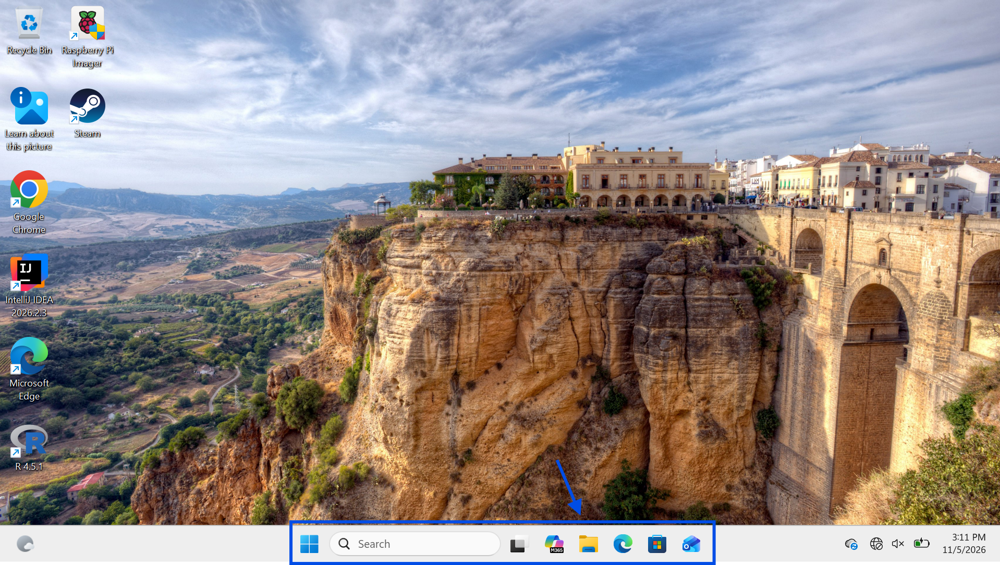
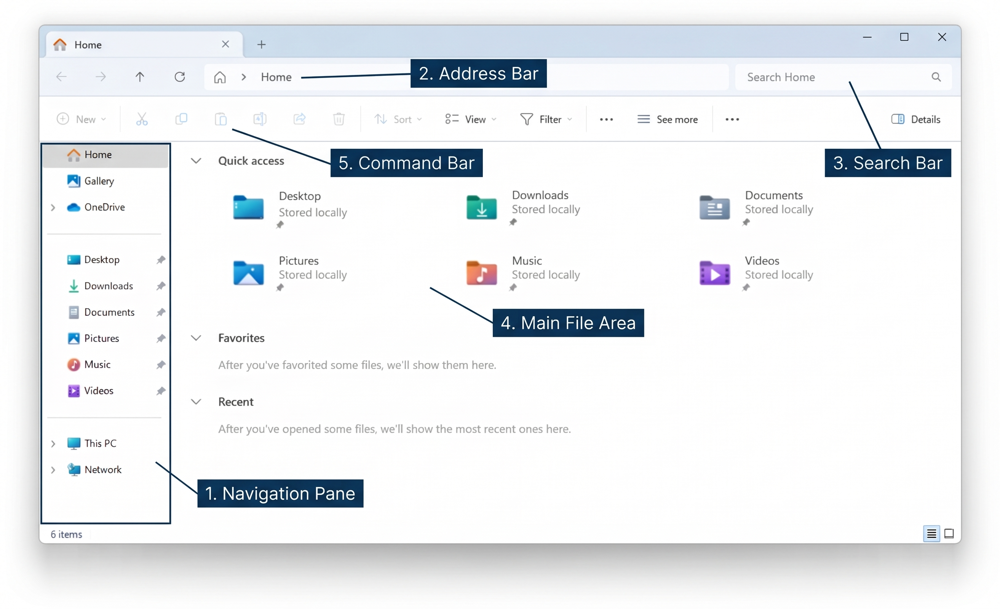
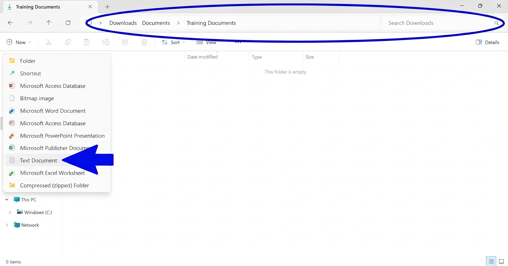

# Windows 11 File Explorer & OneDrive Guide

**Learn how to create, organize, save, download, synchronize, and share files using Windows 11 and Microsoft OneDrive.**

# Introduction

This guide provides step-by-step instructions for using Windows 11 File Explorer and Microsoft OneDrive to create, access, organize, share, and download files.

  
## Getting Started

**Requirements**

- A Windows 11 computer
- A Microsoft account or organization account
- Microsoft OneDrive access
- An internet connection for cloud file access and synchronization

# Table of Contents

1. [File Explorer](#1-file-explorer)
2. [Creating Files and Folders](#2-creating-files-and-folders)
3. [OneDrive Setup and Sync](#3-onedrive-setup-and-sync)
4. [Downloading and Shared Files](#4-downloading-and-shared-files)
5. [Sharing Files and Folders](#5-sharing-files-and-folders)
6. [Troubleshooting](#6-troubleshooting)

---
---
---

<!-- ===================================================== -->
<!-- SECTION 1                                             -->
<!-- ===================================================== -->

# 1. File Explorer

**File Explorer is the Windows application used to browse, create, organize, and manage files and folders.**

  
## 1.1 Opening File Explorer

1. Click the folder icon on the Windows taskbar.

  *Shortcut: Press `Windows + E` on your keyboard.*

---

*Figure 1: Windows Taksbar.*

 
  
## 1.2 Identifying the Main Areas

1. **Navigation pane:** Displays locations such as Home, Desktop, Downloads, Documents, and OneDrive.
2. **Address bar:** Shows the current folder location.
3. **Search box:** Allows you to search for files and folders.
4. **Main file area:** Displays the files and folders in the selected location.
5. **Command bar:** Provides options for creating, copying, moving, and managing files.

*Figure 2: Windows 11 File Explorer main window.*

<!-- ===================================================== -->
<!-- SECTION 2                                             -->
<!-- ===================================================== -->

# 2. Creating Files and Folders

  
## 2.1 Creating a New Folder

1. [Open File Explorer](#11-opening-file-explorer)
2. Navigate to the location where you want to create a folder.
3. Click **New** in the command bar.
4. Select **Folder**.
5. Enter a folder name.
6. Press `Enter`.

  

*Figure 3: Creating Folder in Windows 11.*

  
## 2.2 Creating a New File

1. Open the folder where you want to create the file by Double-clicking.
2. Click **New** in the command bar.
3. Select **Text Document**.
4. Enter a filename.
5. Press `Enter`.

  

*Figure 4: Creating File in Windows 11.*

  
## 2.3 Editing and Saving a File

1. Open the created file.
2. Enter your information.
3. Press `Ctrl + S` to save.
4. Close the application.

  
## 2.4 Renaming a File

1. Select any file.
2. Select **Rename**.
3. Enter the new filename.
4. Press `Enter`.

  
## Example

Create a folder in Documents named `Training Documents`.

Inside the folder, create a text file named `Getting Started.txt`.

Enter the following text:

> This document was created using Windows 11 File Explorer.

Save the file and rename it to `File Explorer Introduction.txt`.

https://github.com/user-attachments/assets/9362dd05-3985-49b4-a51f-53c947406312

# 3. OneDrive Setup and Sync

OneDrive keeps the files in your OneDrive folder synchronized with your cloud storage. Changes you make to files in that folder are updated in the cloud, which can take time depending on your connection and file size.

## 3.1 Sign In

1. Open the Windows Start menu and search for **OneDrive**.
2. Open the OneDrive application.

![Finding OneDrive](

3. Sign in using your Microsoft account or organization account.

*Figure 4: OneDrive Status Icons.*

**Important:** Allow OneDrive to finish synchronizing before disconnecting from the internet.

  
## 3.4 Pause or Resume Sync

1. Click the OneDrive cloud icon and select the **Settings** gear.
2. Select **Pause syncing** and choose a duration, or select **Resume syncing**.

  
## 3.5 Choose Which Folders Sync

1. Click the OneDrive cloud icon and open **Settings**.
2. Select **Account** > **Choose folders**.
3. Select or clear folders, then confirm.

Cleared folders stay available online but do not sync to your computer.

  
## Best Practices

- Let OneDrive finish syncing before shutting down or going offline.
- Check status icons before assuming a file is available offline.
- Monitor your OneDrive storage.
- Deleting a synced file can remove it from all your devices.
  
# 4. Accessing and Downloading Files

## 4.1 Downloading Online-Only Files

1. [Open File Explorer](#11-opening-file-explorer)
2. Navigate to your OneDrive folder.
3. Hold `Ctrl` and select the files you want.
4. Right-click one of the selected files.
5. Select **Always keep on this device**.
6. Wait for the download to complete.

**Note**: The items are now available without an internet connection. Opening an online-only file also downloads it automatically.

*Figure 6:*

  
## 4.2 Free Up Local Storage

Right-click a downloaded file or folder and select **Free up space**. The local copy is removed when possible, and the file stays in OneDrive. Online-only files need an internet connection to open.

  
## 4.3 Open Files Shared with You

1. In your browser, open OneDrive and go to **Shared**.
2. Find the item and, if available, select **Add shortcut to My files**.
3. In File Explorer, open OneDrive and locate the item.

Your permissions determine whether you can view, download, or edit it.

# 5. Sharing Files and Folders

## 5.1 Share with a Specific Person

1. In File Explorer, right-click a file or folder in OneDrive and select **Share**.
2. Enter the recipient's name or email address.
3. Choose **Can view** or **Can edit**.
4. Add an optional message and click **Send**.

*Figure 7:*

## 5.2 Copying a Sharing Link

1. Right-click the item and select **Share**.
2. Choose the audience and permissions.
3. Click **Copy link**, then paste it with `Ctrl + V`.

   
### 5.3 Manage Access

1. In your browser, open OneDrive and find the shared item.
2. Select **Manage access**.
3. Review permissions and links, and remove access when needed.

*Figure 8: Manage access.*

**Best practice:** Share files with specific people and use view-only permissions whenever editing is not required.

## 6. Troubleshooting

This section provides solutions to common Windows 11 File Explorer and OneDrive problems.

### 1. OneDrive Is Missing from File Explorer

**Possible causes:**
- OneDrive is not running.
- The user is not signed in.
- OneDrive has not been configured.

**Solutions:**

1. Open the Windows Start menu.
2. Search for OneDrive.
3. Open the OneDrive application.
4. Sign in using your Microsoft or organization account.
5. Complete the setup process.
6. Reopen File Explorer and check the navigation pane.

### 2. Files Are Not Synchronizing

**Possible causes:**
- No internet connection.
- OneDrive synchronization is paused.
- Storage is full.
- A file has a synchronization error.

**Solutions:**

1. Check your internet connection.
2. Click the OneDrive cloud icon in the taskbar.
3. Check for error messages.
4. Confirm synchronization is not paused.
5. Check your available OneDrive storage.
6. Resolve any errors displayed by OneDrive.

### 3. Files Will Not Download

**Possible causes:**
- No internet connection.
- Insufficient local storage.
- OneDrive is not signed in.
- The file is no longer available or access has been removed.

**Solutions:**

1. Verify your internet connection.
2. Confirm you are signed in to OneDrive.
3. Check available storage on your computer.
4. Open File Explorer and locate the file.
5. Right-click the file and select **Always keep on this device**.
6. Wait for the download to complete.

### 4. Red X Appears Next to a File

A red X indicates a OneDrive synchronization problem.

**Solutions:**

1. Click the OneDrive cloud icon.
2. Review the displayed error message.
3. Check whether the file name contains unsupported characters.
4. Verify that you have permission to access the file.
5. Check your available cloud storage.
6. Follow the instructions provided by OneDrive to resolve the error.

### 5. OneDrive Storage Is Full

**Solutions:**

1. Review your OneDrive storage usage.
2. Identify files that are no longer needed.
3. Move important files elsewhere before deleting anything.
4. Remove unnecessary files from OneDrive.
5. Empty the OneDrive recycle bin if appropriate.
6. Contact your organization's IT department if additional storage is required.

**Important:** Deleting a file from OneDrive can also remove it from other synchronized devices.

### 6. Files Are Not Appearing on Another Device

**Solutions:**

1. Confirm both devices are connected to the internet.
2. Verify that both devices use the same OneDrive account.
3. Check the OneDrive synchronization status on the original device.
4. Wait for synchronization to finish.
5. Refresh File Explorer on the second device.
6. Check OneDrive online to confirm the file exists.

### 7. Recover a Deleted File

1. Open OneDrive in your web browser.
2. Navigate to the **Recycle bin**.
3. Locate the deleted file.
4. Select the file.
5. Click **Restore**, if available.

Recovery availability depends on account type, retention policies, and whether the file has been permanently deleted.

### Additional Support

If these troubleshooting steps do not resolve the problem:

- Contact your organization's IT support team.
- Visit [Microsoft OneDrive Support](https://support.microsoft.com/onedrive).
- Review the OneDrive synchronization status and error messages.

---

**Document Version:** 1.0  
**Platform:** Windows 11  
**Last Updated:** November 2026

