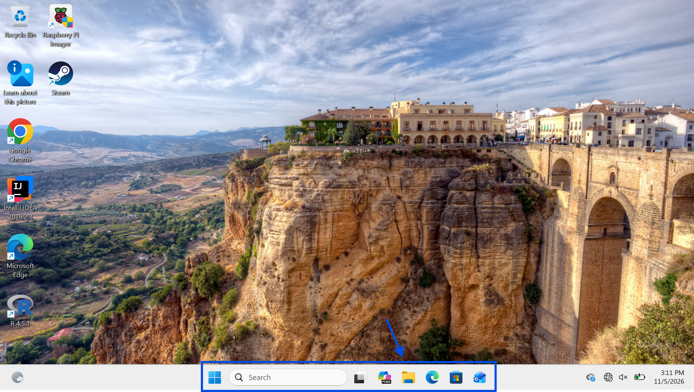
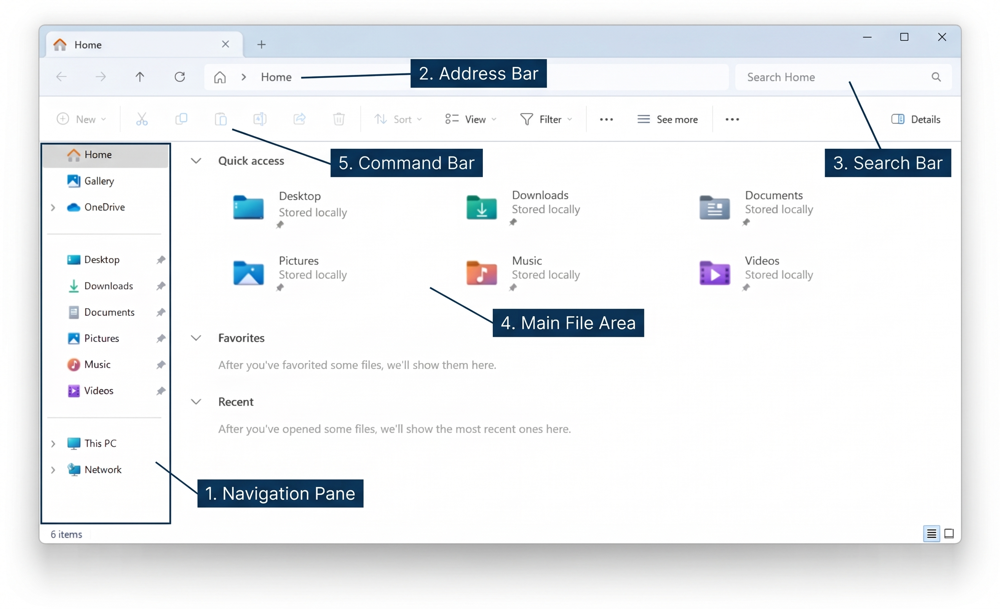
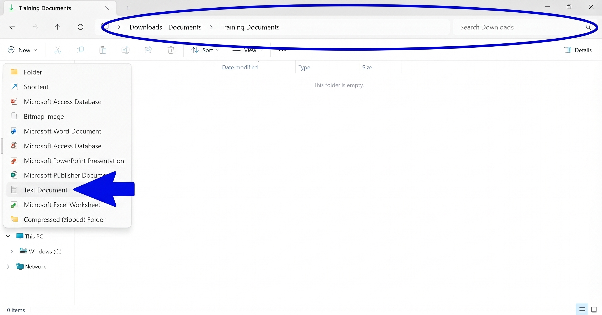
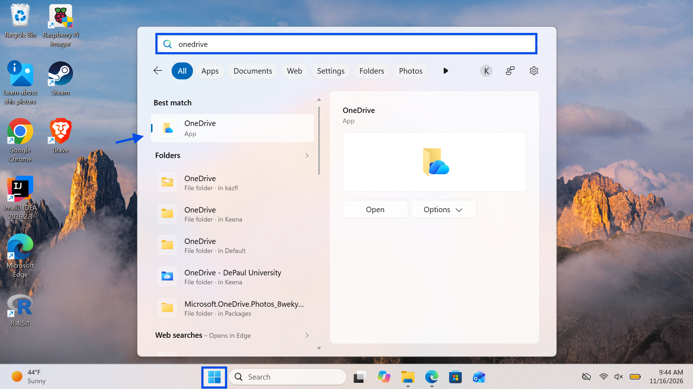
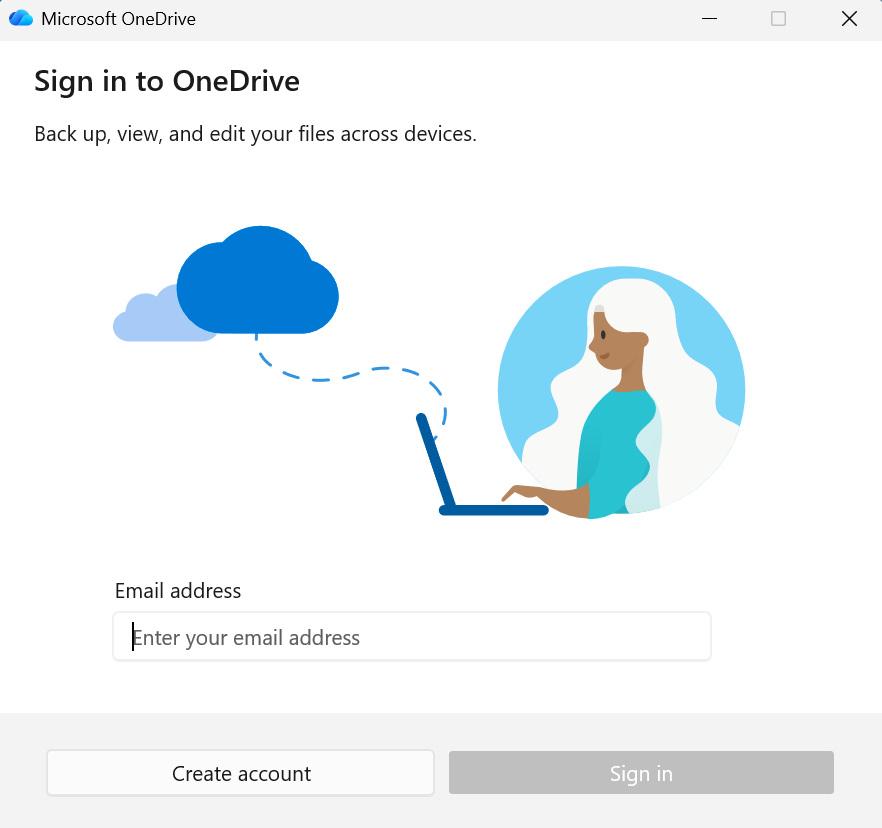
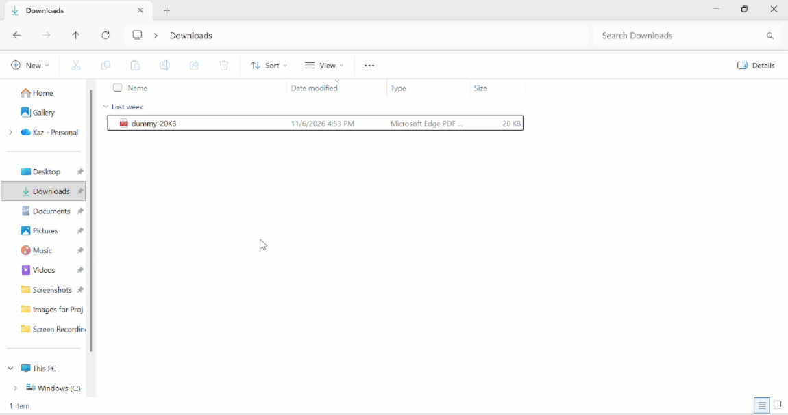
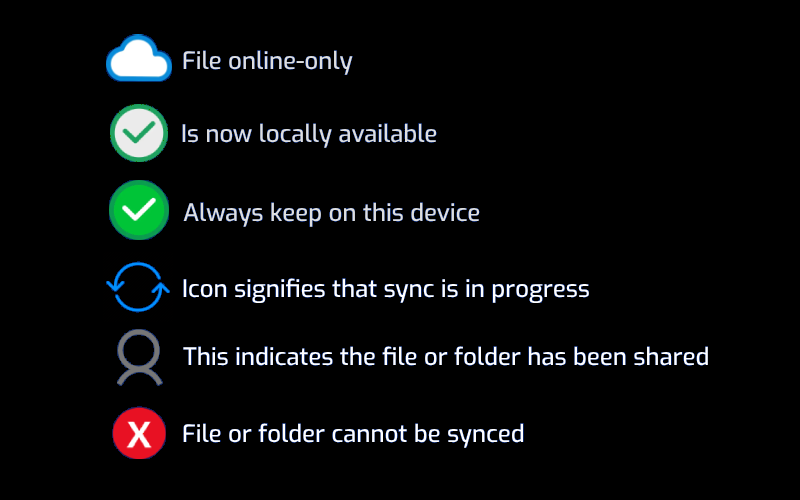
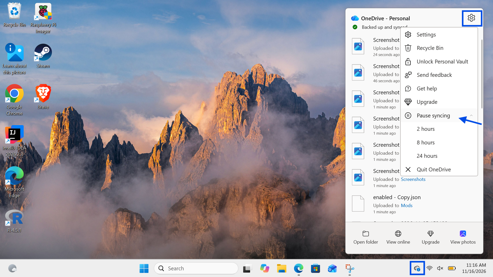
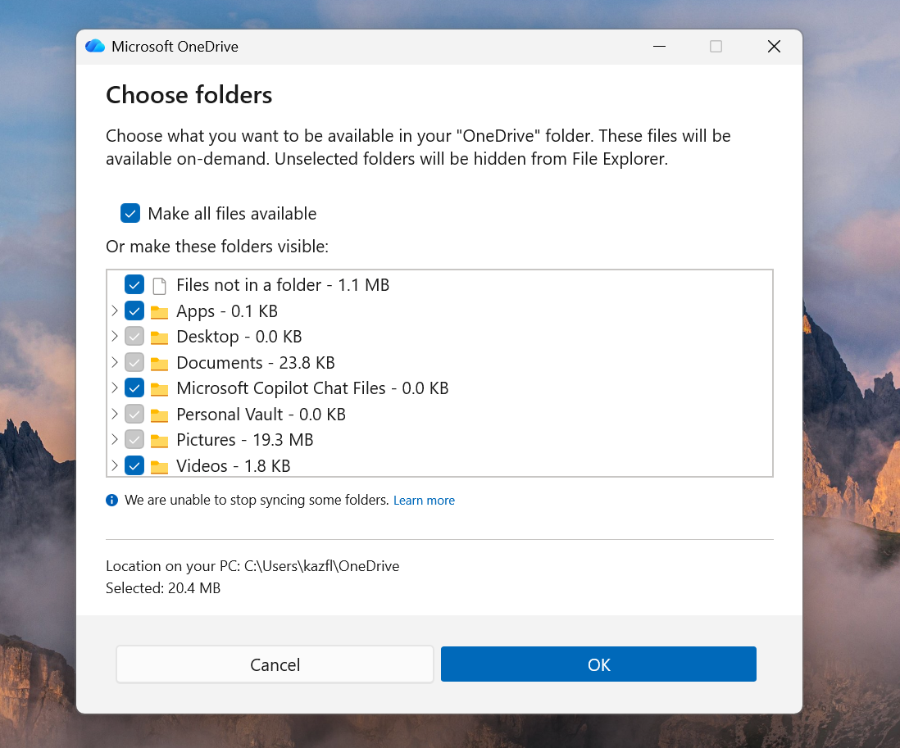
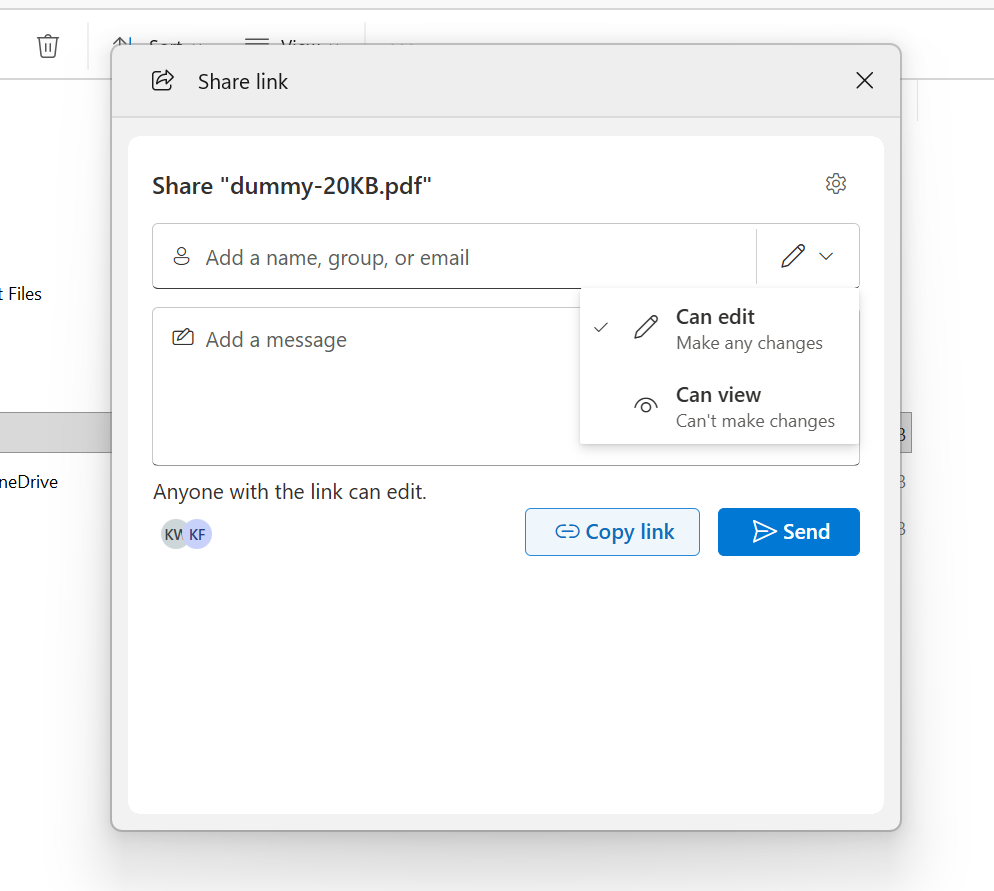

# 🗂️ Windows 11 File Explorer & OneDrive Guide

**Learn how to create, organize, save, download, synchronize, and share files using Windows 11 and Microsoft OneDrive.**

  
## Getting Started

**Requirements ✅**

- A Windows 11 computer
- A Microsoft account or organization account
- Microsoft OneDrive access
- An internet connection for cloud file access and synchronization

## 📑 Table of Contents

1. 📁 [File Explorer](#1-file-explorer)
2. 📝 [Creating Files and Folders](#2-creating-files-and-folders)
3. ☁️ [OneDrive Setup and Sync](#3-onedrive-setup-and-sync)
4. 📥 [Offline Files and Storage](#4-offline-files-and-storage)
5. 🔗 [Sharing Files and Folders](#5-sharing-files-and-folders)
6. 🛠️ [Troubleshooting](troubleshooting/README.md)

---

# 📁 1. File Explorer

**File Explorer is the Windows application used to browse, create, organize, and manage files and folders.**

  
## 1.1 Opening File Explorer

1. Click the folder icon on the Windows taskbar.

  *Shortcut: Press `Windows + E` on your keyboard.*

---

*Figure 1: Windows Taskbar.*

 
  
## 1.2 Identifying the Main Areas

1. **Navigation pane:** Displays locations such as Home, Desktop, Downloads, Documents, and OneDrive.
2. **Address bar:** Shows the current folder location.
3. **Search box:** Allows you to search for files and folders.
4. **Main file area:** Displays the files and folders in the selected location.
5. **Command bar:** Provides options for creating, copying, moving, and managing files.

*Figure 2: Windows 11 File Explorer main window.*

---

# 📝 2. Creating Files and Folders

  
## 2.1 Creating a Folder

1. [Open File Explorer](#11-opening-file-explorer) and navigate to the location where you want to create a folder.
2. Click **New** in the command bar then select **Folder**.
3. Enter a folder name and press `Enter`.

*Figure 3: Creating a Folder in Windows 11.*

  
## 2.2 Creating a File

1. Open the folder where you want to create the file by Double-clicking.
2. Click **New** in the command bar then select **Text Document**.
3. Enter a filename and press `Enter`.

*Figure 4: Creating File in Windows 11.*

  
## 2.3 Editing and Saving a File

1. Open a created file and enter your text.
2. Press `Ctrl + S` to save, then exit.

  
## 2.4 Renaming a File

1. Select any file and click **Rename**.
2. Enter the new filename and press `Enter`.

  
## Example

1. Create a folder in Documents named `Training Documents`.
2. Inside the folder, create a text file named `Getting Started`.
3. Enter the following text:
> This document was created using Windows 11 File Explorer.
4. Save the file and rename it to `File Explorer Introduction`.

https://github.com/user-attachments/assets/9362dd05-3985-49b4-a51f-53c947406312

*Figure 5: Folder and File Example Vid.*

---

# ☁️ 3. OneDrive Setup and Sync

OneDrive keeps the files in your OneDrive folder synchronized with your cloud storage. Changes you make to files in that folder are updated in the cloud, which can take time depending on your connection and file size.

## 3.1 Sign In

1. Open the Windows Start menu and search for **OneDrive**, and open the application.

*Figure 6: Finding OneDrive.*

2. Sign in using your Microsoft account or organization account and follow the setup instructions.

*Figure 7: Logging in to OneDrive.*
   

  
## 3.2 Saving Files to OneDrive

1. Right-click the file you want to move and select **Cut**.
2. Open the destination folder in OneDrive.
3. Right-click inside the folder and select **Paste**.
4. Wait for OneDrive to synchronize the file.

*Example Video*

*Figure 8: Saving Files in OneDrive.*

## 3.3 Understanding OneDrive Status Icons

**In File Explorer:** Open your OneDrive folder and look at the icon next to each file or folder.

| Status Icon | Meaning |
|---|---|
| Blue cloud | File is online-only |
| Green outlined check | File is downloaded and locally available |
| Solid green circle with check | File is set to always remain on this device |
| Blue circular arrows | File is synchronizing |
| Red X | Synchronization error |

*Figure 9: OneDrive Status Icons.*

To see upload and download activity, click the OneDrive cloud icon in the taskbar notification area (click the upward arrow if it is hidden).

  
## 3.4 Pause or Resume Sync

1. Click the OneDrive cloud icon on the taskbar and select the **Settings** gear.
2. Select **Pause syncing** and choose a duration, or select **Resume syncing**.

*Figure 10: Pausing OneDrive Sync.*

  
## 3.5 Choose Which Folders Sync

1. Click the OneDrive cloud icon and open **Settings**.
2. Select **Account** then **Choose folders**.
3. Select or clear folders, then confirm.

Cleared folders stay available online but do not sync to your computer.

*Figure 11: Selecting Synced Folders*

  
## Best Practices

- Let OneDrive finish syncing before shutting down or going offline.
- Check status icons before assuming a file is available offline.
- Monitor your OneDrive storage.
  
> [!WARNING]
> Deleting a synced file can remove it from all your devices.

---
  

# 📥 4. Offline Files and Storage

## 4.1 Download Files and Keep Them Offline

1. [Open File Explorer](#11-opening-file-explorer) and go to your OneDrive folder.
2. Hold `Ctrl` and select the files or folders you want.
3. Right-click one of the selected files and select **Always keep on this device**.
4. Wait for the download to complete.

**Note**: The items are now available without an internet connection. Opening an online-only file also downloads it automatically.

*Figure 12: Downloading Online-Only Files.*

  
## 4.2 Free Up Local Storage

Right-click a downloaded file or folder and select **Free up space**. The local copy is removed when possible, and the file stays in OneDrive. Online-only files need an internet connection to open.

---

# 🔗 5. Sharing Files and Folders

## 5.1 Share with a Specific Person

1. In File Explorer, right-click a file or folder in OneDrive and select **Share**.
2. Enter the recipient's name or email address.
3. Choose **Can view** or **Can edit**.
4. Add an optional message and click **Send**.

*Figure 13: Share Dialog.*

## 5.2 Copy a Sharing Link

1. Right-click the item and select **Share**.
2. Choose the audience and permissions.
3. Click **Copy link**, then paste it with `Ctrl + V`.

   
## 5.3 Manage Access

1. In your browser, open OneDrive and find the shared item.
2. Select **Manage access**.
3. Review permissions and links, and remove access when needed.

https://github.com/user-attachments/assets/597f3235-a13c-4ff4-bd84-d178660e8709

*Figure 14: Remove Access.*

> [!TIP]
> Share with specific people and use view-only permissions unless editing is needed.

## 5.4 Open Files Shared with You

1. In your browser, open OneDrive and go to **Shared**.
2. Find the item and, if available, select **Add shortcut to My files**.
3. In File Explorer, open OneDrive and locate the item.

Your permissions determine whether you can view, download, or edit it.

---

# 🛠️ 6. Troubleshooting

Having a problem? Open the [Troubleshooting guide](troubleshooting/README.md), or jump straight to a fix:

| | Problem | Fix |
|:-:|---|---|
| 🔎 | OneDrive is missing from File Explorer | [View fix](troubleshooting/onedrive-missing.md) |
| 🔄 | Files are not syncing, or a red X appears | [View fix](troubleshooting/sync-errors.md) |
| ⬇️ | Files will not download | [View fix](troubleshooting/download-problems.md) |
| 💾 | OneDrive storage is full | [View fix](troubleshooting/storage-full.md) |
| 💻 | Files are missing on another device | [View fix](troubleshooting/missing-on-another-device.md) |
| ♻️ | Recovering a deleted file | [View fix](troubleshooting/recover-deleted-file.md) |

---

**Document Version:** 1.0  
**Platform:** Windows 11  
**Last Updated:** November 2026

