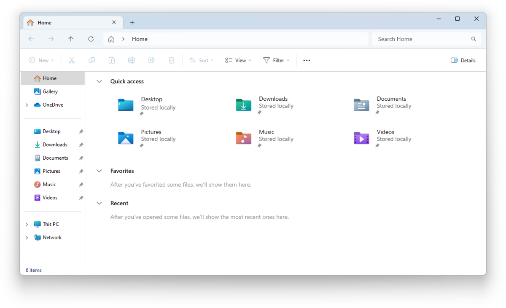
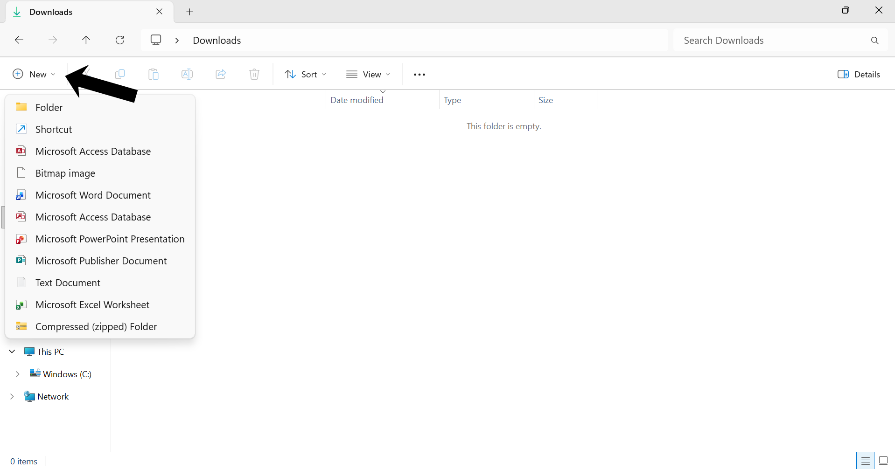
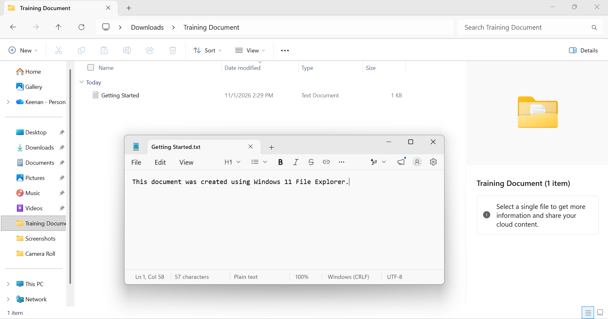
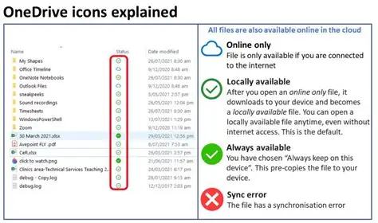

# Windows 11 File Explorer & OneDrive Guide

## Introduction

This guide provides step-by-step instructions for using Windows 11 File Explorer and Microsoft OneDrive to create, access, organize, share, and download files.

The guide is designed for users with little or no prior experience.
## Table of Contents

1. [Getting Started](#getting-started)
2. [Understanding File Explorer](#understanding-file-explorer)
3. [Creating Files and Folders](#creating-files-and-folders)
4. [Accessing OneDrive](#accessing-onedrive)
5. [Saving Files to OneDrive](#saving-files-to-onedrive)
6. [Accessing and Downloading Files](#accessing-and-downloading-files)
7. [Sharing Files and Folders](#sharing-files-and-folders)
8. [Managing OneDrive Sync](#managing-onedrive-sync)
9. [Troubleshooting](#troubleshooting)

## Getting Started

### Requirements

- A Windows 11 computer
- A Microsoft account or organization account
- Microsoft OneDrive access
- An internet connection for cloud file access and synchronization

## Understanding File Explorer

File Explorer is the Windows application used to browse, create, organize, and manage files and folders.

### Opening File Explorer

1. Click the folder icon on the Windows taskbar.
2. Alternatively, press `Windows + E` on your keyboard.

### Identifying the Main Areas

1. **Navigation pane:** Displays locations such as Home, Desktop, Downloads, Documents, and OneDrive.
2. **Address bar:** Shows the current folder location.
3. **Search box:** Allows you to search for files and folders.
4. **Main file area:** Displays the files and folders in the selected location.
5. **Command bar:** Provides options for creating, copying, moving, and managing files.

*Figure 1: Windows 11 File Explorer main window.*

## Creating Files and Folders

### Creating a New Folder

*Figure 2: Creating Folder in Windows 11.*

1. [Open File Explorer](#Opening-File-Explorer)
2. Navigate to the location where you want to create a folder.
3. Click **New** in the command bar.
4. Select **Folder**.
5. Enter a folder name.
6. Press `Enter`.

### Creating a New File

1. Open the folder where you want to create the file.
2. Click **New** in the command bar.
3. Select **Text Document**.
4. Enter a filename.
5. Press `Enter`.

### Editing and Saving a File

1. Double-click the file to open it.
2. Enter your information.
3. Press `Ctrl + S` to save.
4. Close the application.

### Renaming a File
  
1. Right-click the file.
2. Select **Rename**.
3. Enter the new filename.
4. Press `Enter`.

### Example

Create a folder named `Training Documents`.

Inside the folder, create a text file named `Getting Started.txt`.

Enter the following text:

> This document was created using Windows 11 File Explorer.

Save the file and rename it to `File Explorer Introduction.txt`.

*Figure 3: Creating and Editing a file in Windows 11.*

## Accessing OneDrive

### Locating OneDrive

1. [Open File Explorer](#Opening-File-Explorer)
2. Locate OneDrive in the navigation pane.
3. Click OneDrive to open the folder.

OneDrive may appear as OneDrive - Personal or OneDrive - [Organization].

### Signing In to OneDrive

1. Open the Windows Start menu.
2. Search for OneDrive.
3. Open the OneDrive application.
4. Sign in using your Microsoft account or organization account.
5. Follow the setup instructions.
6. Confirm the location of your OneDrive folder.

### Creating a Folder in OneDrive

1. Open OneDrive in File Explorer.
2. Click **New** in the command bar.
3. Select **Folder**.
4. Enter a folder name.
5. Press `Enter`.

## Saving Files to OneDrive

1. Locate the file you want to move.
2. Right-click the file and select **Cut**.
3. Open the destination folder in OneDrive.
4. Right-click inside the folder and select **Paste**.
5. Wait for OneDrive to synchronize the file.

### Understanding OneDrive Status Icons

*Figure 4: OneDrive Status Icons.*

**Important:** Allow OneDrive to finish synchronizing before disconnecting from the internet.

## Accessing and Downloading Files

### Downloading an Online-Only File

1. [Open File Explorer](#Opening-File-Explorer)
2. Navigate to your OneDrive folder.
3. Locate the file with a blue cloud icon.
4. Double-click the file to download and open it.

Alternatively:

1. Right-click the file.
2. Select **Always keep on this device**.
3. Wait for the download to complete.

### Downloading Multiple Files

1. Open the OneDrive folder.
2. Hold `Ctrl` and select the files you want.
3. Right-click one of the selected files.
4. Select **Always keep on this device**.
5. Wait for the download to complete.

### Accessing Shared Files

1. Open OneDrive in your browser.
2. Navigate to **Shared**.
3. Locate the file or folder shared with you.
4. If available, select **Add shortcut to My files**.
5. Open File Explorer.
6. Navigate to OneDrive and locate the shared item.

Shared file permissions determine whether you can view, download, or edit the file.

### Making Files Available Offline

1. [Open File Explorer](#Opening-File-Explorer)
2. Navigate to OneDrive.
3. Right-click the desired file or folder.
4. Select **Always keep on this device**.
5. Wait for the green checkmark to appear.

### Freeing Up Local Storage

1. Right-click a locally downloaded OneDrive file.
2. Select **Free up space**.
3. Windows removes the local copy when possible while retaining the file in OneDrive.

**Important:** Files marked as online-only require an internet connection to download and open.

## Sharing Files and Folders

### Sharing a File

1. [Open File Explorer](#Opening-File-Explorer)
2. Navigate to your OneDrive folder.
3. Right-click the file you want to share.
4. Select **Share**.

### Sharing with a Specific Person

1. Enter the recipient's name or email address.
2. Review the permission settings.
3. Choose whether the recipient can view or edit the file.
4. Add an optional message.
5. Click **Send**.

### Copying a Sharing Link

1. Right-click the file.
2. Select **Share**.
3. Review the link settings.
4. Select the appropriate audience.
5. Click **Copy link**.
6. Paste the link into an email or message using `Ctrl + V`.

### Sharing a Folder

1. Open File Explorer.
2. Navigate to OneDrive.
3. Right-click the folder.
4. Select **Share**.
5. Enter the recipient's email address.
6. Review the permissions.
7. Click **Send**.

### Managing Access

1. Open OneDrive in your browser.
2. Locate the shared file or folder.
3. Select **Manage access**.
4. Review existing permissions and sharing links.
5. Remove access or stop sharing when necessary.

**Best practice:** Share files with specific people and use view-only permissions whenever editing is not required.

## Managing OneDrive Sync

### Understanding OneDrive Synchronization

OneDrive synchronization keeps files in your OneDrive folder on your Windows 11 computer connected to your cloud storage.

When you create, edit, rename, or move files inside your synchronized OneDrive folder, OneDrive updates those changes in the cloud.

**Important:** Changes may take time to synchronize depending on your internet connection and file size.

### 1. Check OneDrive Sync Status

1. [Open File Explorer](#Opening-File-Explorer)
2. Navigate to your OneDrive folder.
3. Locate the Status column.
4. Review the icon displayed next to each file or folder.

| Status Icon | Meaning |
|---|---|
| Blue cloud | File is online-only |
| Green outlined check | File is downloaded and locally available |
| Solid green circle with check | File is set to always remain on this device |
| Blue circular arrows | File is synchronizing |
| Red X | Synchronization error |

### 2. Check OneDrive Sync Activity

1. Locate the OneDrive cloud icon in the Windows taskbar notification area.
2. Click the OneDrive icon.
3. Review the synchronization activity.
4. Check whether files are uploading, downloading, or waiting to synchronize.

If the icon is not visible, click the upward arrow to display hidden taskbar icons.

### 3. Pause and Resume Synchronization

To pause synchronization:

1. Click the OneDrive cloud icon.
2. Select the Settings gear icon.
3. Select **Pause syncing**.
4. Choose the desired pause duration.

To resume synchronization:

1. Click the OneDrive cloud icon.
2. Open the settings menu.
3. Select **Resume syncing**.

### 4. Choose Which Folders Synchronize

1. Click the OneDrive cloud icon.
2. Open **Settings**.
3. Select the **Account** section.
4. Click **Choose folders**.
5. Select or clear the folders you want synchronized.
6. Confirm your selections.

Folders that are not selected may remain available online but will not be synchronized locally.

### 5. Make Files Available Offline

1. [Open File Explorer](#Opening-File-Explorer)
2. Navigate to OneDrive.
3. Right-click the desired file or folder.
4. Select **Always keep on this device**.
5. Wait for the solid green checkmark.

The file will now be stored locally and available without an internet connection.

### 6. Free Up Local Storage

1. [Open File Explorer](#Opening-File-Explorer)
2. Navigate to OneDrive.
3. Right-click a downloaded file or folder.
4. Select **Free up space**.

This removes the local copy when possible while retaining the file in OneDrive.

### Best Practices

- Wait for synchronization to finish before shutting down your computer.
- Check OneDrive status icons before assuming a file is available offline.
- Use **Always keep on this device** for important files needed without internet access.
- Check available OneDrive storage regularly.
- Avoid deleting files unless you intend to remove them from synchronized storage.

## Troubleshooting

This section provides solutions to common Windows 11 File Explorer and OneDrive problems.

### 1. OneDrive Is Missing from File Explorer

**Possible causes:**
- OneDrive is not running.
- The user is not signed in.
- OneDrive has not been configured.

**Solutions:**

1. Open the Windows Start menu.
2. Search for OneDrive.
3. Open the OneDrive application.
4. Sign in using your Microsoft or organization account.
5. Complete the setup process.
6. Reopen File Explorer and check the navigation pane.

### 2. Files Are Not Synchronizing

**Possible causes:**
- No internet connection.
- OneDrive synchronization is paused.
- Storage is full.
- A file has a synchronization error.

**Solutions:**

1. Check your internet connection.
2. Click the OneDrive cloud icon in the taskbar.
3. Check for error messages.
4. Confirm synchronization is not paused.
5. Check your available OneDrive storage.
6. Resolve any errors displayed by OneDrive.

### 3. Files Will Not Download

**Possible causes:**
- No internet connection.
- Insufficient local storage.
- OneDrive is not signed in.
- The file is no longer available or access has been removed.

**Solutions:**

1. Verify your internet connection.
2. Confirm you are signed in to OneDrive.
3. Check available storage on your computer.
4. Open File Explorer and locate the file.
5. Right-click the file and select **Always keep on this device**.
6. Wait for the download to complete.

### 4. Red X Appears Next to a File

A red X indicates a OneDrive synchronization problem.

**Solutions:**

1. Click the OneDrive cloud icon.
2. Review the displayed error message.
3. Check whether the file name contains unsupported characters.
4. Verify that you have permission to access the file.
5. Check your available cloud storage.
6. Follow the instructions provided by OneDrive to resolve the error.

### 5. OneDrive Storage Is Full

**Solutions:**

1. Review your OneDrive storage usage.
2. Identify files that are no longer needed.
3. Move important files elsewhere before deleting anything.
4. Remove unnecessary files from OneDrive.
5. Empty the OneDrive recycle bin if appropriate.
6. Contact your organization's IT department if additional storage is required.

**Important:** Deleting a file from OneDrive can also remove it from other synchronized devices.

### 6. Files Are Not Appearing on Another Device

**Solutions:**

1. Confirm both devices are connected to the internet.
2. Verify that both devices use the same OneDrive account.
3. Check the OneDrive synchronization status on the original device.
4. Wait for synchronization to finish.
5. Refresh File Explorer on the second device.
6. Check OneDrive online to confirm the file exists.

### 7. Recover a Deleted File

1. Open OneDrive in your web browser.
2. Navigate to the **Recycle bin**.
3. Locate the deleted file.
4. Select the file.
5. Click **Restore**, if available.

Recovery availability depends on account type, retention policies, and whether the file has been permanently deleted.

### Additional Support

If these troubleshooting steps do not resolve the problem:

- Contact your organization's IT support team.
- Visit [Microsoft OneDrive Support](https://support.microsoft.com/onedrive).
- Review the OneDrive synchronization status and error messages.

---

**Document Version:** 1.0  
**Platform:** Windows 11  
**Last Updated:** November 2026

